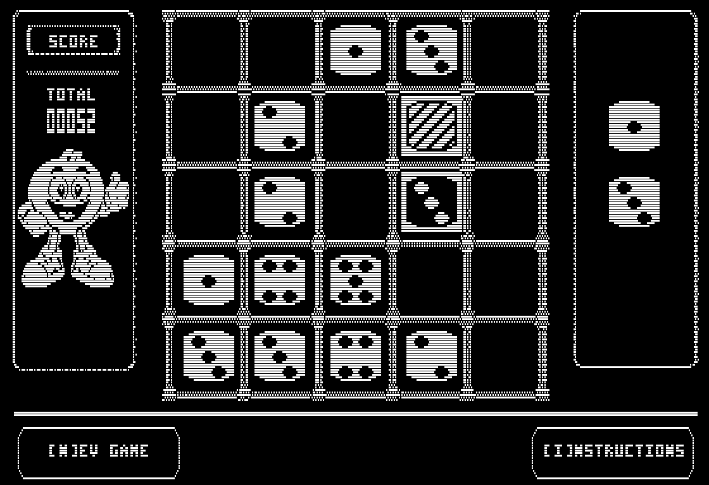
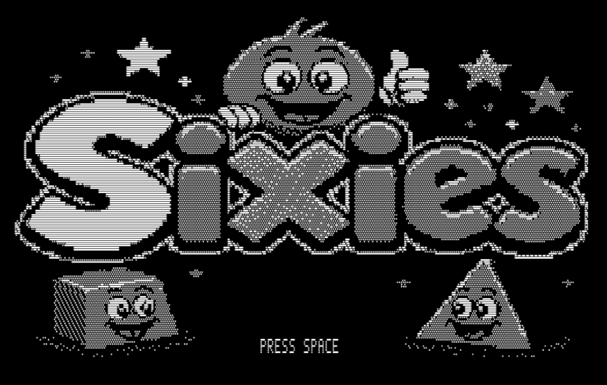

# SIXIES for Apple IIe

A native C/6502 dice-merging puzzle game for an enhanced Apple IIe with 128KB
RAM, monochrome double-hi-resolution graphics, and a bootable ProDOS disk.

## Download

[Download the Apple IIe release](https://github.com/SkiltonUSA/Sixies-Apple-IIe/releases/latest)
as a `.po` or `.dsk` disk image.

## Screenshots

| Gameplay | Title |
| --- | --- |
|  |  |

## Build

```sh
make setup-tools
make test
make disk
make run
```

Builds are written to `apple2/build/`. See the [Apple IIe development guide](apple2/README.md)
and [game rules](apple2/RULES_README.md). The shared mascot input in `src/assets`
is included locally; no C64 or Atari checkout is required.

## Source history and other platforms

Imported from `Sixies_Development` branch `sixies---apple-ii`, commit
`96b9a25fac815acbb84aa86f244a00c282107089`. Earlier history and releases remain
in the [original repository](https://github.com/SkiltonUSA/Sixies_Development/tree/sixies---apple-ii).
Published release binaries are copied without modification.

Other editions: [C64](https://github.com/SkiltonUSA/Sixies-C64),
[Atari](https://github.com/SkiltonUSA/Sixies-Atari-800),
[VZ200](https://github.com/SkiltonUSA/Sixies-VZ200),
[Game Boy](https://github.com/SkiltonUSA/Sixies-GameBoy).
